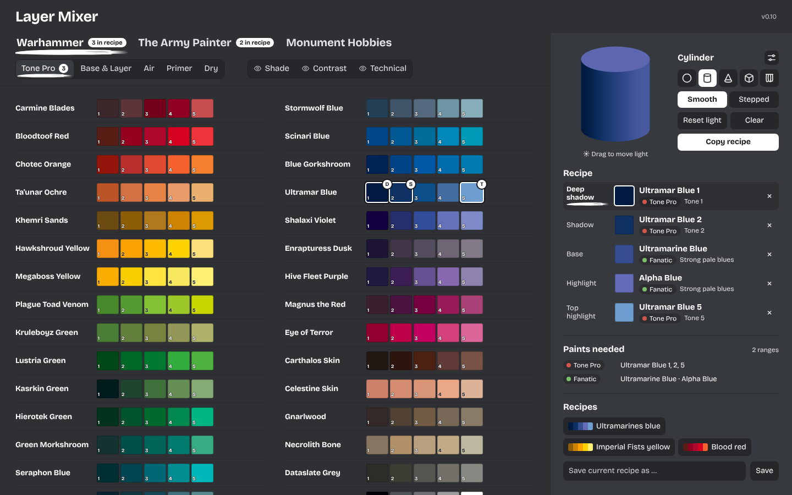

# Layer Mixer

Plan your layering before you paint: combine acrylic paint tones from shadow to highlight and preview the result on a shaded form. Ranges can be mixed within one recipe.

Vibecoded by Duempelhuber.



## Included paint ranges

| Brand | Range | Paints |
|---|---|---|
| Warhammer | Tone Pro | 30 colours × 5 tones |
| Warhammer | Base & Layer | 128 paints, plus 22 metallics for reference |
| Warhammer | Air | 60 paints, plus 17 metallics and clear paints for reference |
| Warhammer | Primer | 10 primers, plus 2 metallic primers for reference |
| Warhammer | Dry | 29 paints, plus 2 metallics for reference |
| Warhammer | Shade | 19 washes, for reference |
| Warhammer | Contrast | 61 paints, for reference |
| Warhammer | Technical | 25 texture, effect and medium paints, for reference |
| The Army Painter | Warpaints Fanatic | 27 colour ranges (170 paints) and 4 Masterclass paints, plus 20 metallics for reference |
| The Army Painter | Warpaints Air | 104 paints, plus 22 metallic and fluorescent paints for reference |
| The Army Painter | Colour Primer | 21 primers, plus 5 metallic primers and varnishes for reference |
| The Army Painter | Speedpaint | 90 paints, for reference |
| The Army Painter | Wash | 18 washes, for reference |
| The Army Painter | Effects | 18 effect paints, glows and media, for reference |
| Monument Hobbies | Pro Acryl | 111 paints, plus 11 metallics for reference |
| Monument Hobbies | Expert Acrylics | 22 paints |
| Monument Hobbies | Prime | 13 primers |
| Monument Hobbies | 1-Step | 24 paints, for reference |
| Monument Hobbies | Wash | 16 washes and transparents, for reference |
| Monument Hobbies | Specials | 29 fluorescents, pigments, basing textures and media, for reference |

## How to use

1. Download **`layer-mixer.html`** from the latest [release](../../releases/latest).
2. Double-click the file. It opens in your web browser (Chrome, Edge, Firefox or Safari).
3. No installation, no account, no internet connection needed.

**Updating:** download the new `layer-mixer.html` and replace the old file in the same place. Your saved recipes stay in the browser. The version is shown in the top right corner of the tool.

**In the tool**

- Select a layer in the recipe (Deep shadow, Shadow, Base, Highlight, Top highlight), then click a paint in the chart.
- Choose a brand with the tabs at the top and a range with the buttons below. Paints you use are marked in the chart.
- Ranges marked with an eye and the metallic, clear and fluorescent paints are listed for reference only and can't be added to a recipe. Products without a colour of their own show a letter: M medium, V varnish, P primer.
- *Smooth* shows a soft blend, *Stepped* shows the individual layers.
- Choose the form for the preview: sphere, cylinder, cone, block or cloth.
- Drag on the preview to move the light (or use the arrow keys). Double-click or *Reset light* brings it back.
- *Light strength* (button next to the form name) sets how much of the form the highlights cover.
- *Paints needed* lists the pots you need for the recipe.
- Load one of the examples, or save your own recipes. Saved recipes stay in your browser on your computer.

## Fonts

Layer Mixer uses Bricolage Grotesque by The Bricolage Grotesque Project Authors, licensed under the SIL Open Font License 1.1 (`src/fonts/OFL.txt`).

## Privacy

Layer Mixer runs completely offline. It does not load anything from the internet and does not send any data anywhere.

## Notes

Layer Mixer is vibecoded: the code was written with an AI coding assistant (Claude by Anthropic) under the direction of Duempelhuber, who designed and reviewed it.

Colour values are screen colours, not an exact match for the paint in the pot. Compare on the model before you paint.

Layer Mixer is a private, non-commercial project and is not affiliated with Games Workshop or The Army Painter. All product names are trademarks of their respective owners and are only used to identify the products.

## License

Copyright (c) 2026 Duempelhuber. All rights reserved. The tool may be downloaded and used for personal, non-commercial purposes; any redistribution or modification requires permission. See [LICENSE](LICENSE).

## Changes

See [ChangeLog.txt](ChangeLog.txt).

## For contributors

```
data/            one JSON file per paint range
src/             the app (HTML, CSS, JS) and its icon
build.py         bundles everything into dist/layer-mixer.html
tests/           automated browser tests (Playwright)
```

Build and test:

```
python3 build.py
npm install playwright && node tests/run-tests.js
```

Releasing: set `VERSION` in `build.py`, add an entry to `ChangeLog.txt` and push to `main`. If that version has no release yet, a GitHub Actions workflow builds the tool, runs the tests and publishes the release with `layer-mixer.html` and the change log entry.

Adding a paint range: create `data/<brand>-<range>.json` in the same format as the existing files (unique `id`, `brand`, `range`, `short`, optional `color`, and `rows` of `paints` with `name` and `hex`, ordered dark → light; optional per paint: `type`, `info`; per range: `series` (paints form a fixed dark → light series and get position numbers), `numbered` (tones), `info`, `translucent`), add the file name to `RANGES` in `build.py`, then build and test. Ranges with the same `brand` are grouped under one brand tab.
