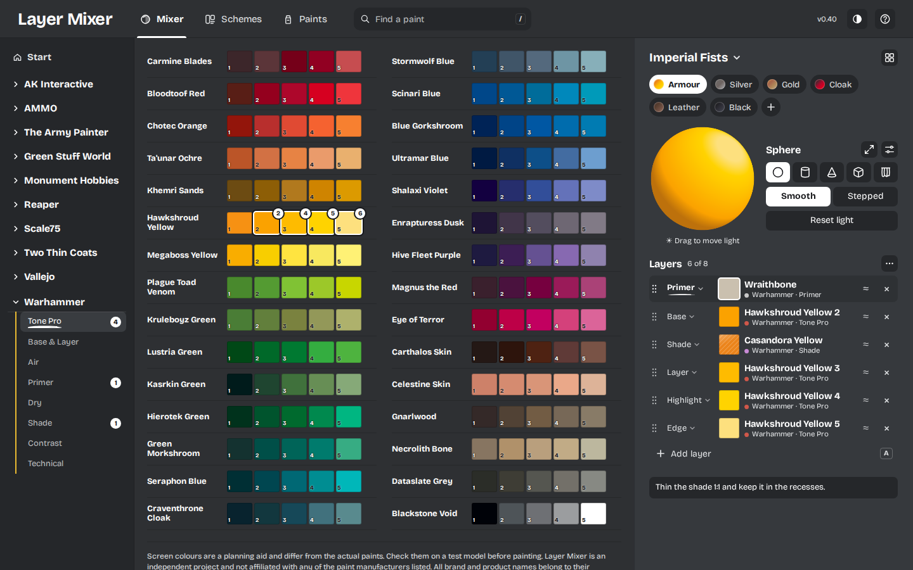
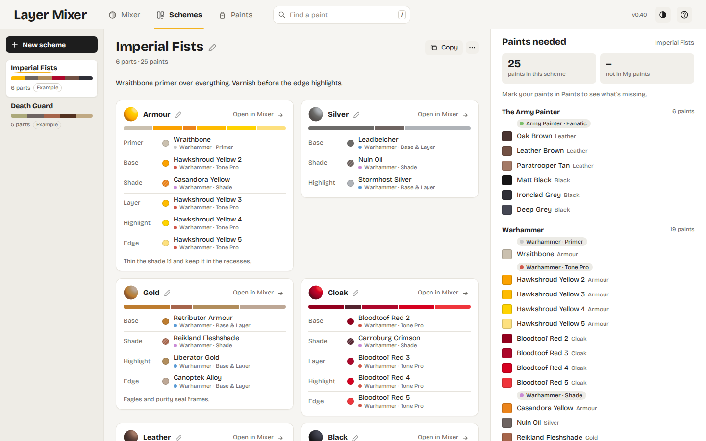

# Layer Mixer

Plan your layering before you paint: combine acrylic paint tones from shadow to highlight and preview the result on a shaded form. Ranges can be mixed freely, and a scheme keeps all parts of a model together.

**New in 0.40: the scheme creator.** Plan a whole model as a scheme: one part per area (armour, cloak, metal …), each with its own layers from primer to edge highlight, and a list of the paints you still need.

Vibecoded by Duempelhuber.





## Included paint ranges

| Brand | Ranges |
|---|---|
| Warhammer | Tone Pro, Base & Layer, Air, Primer, Dry, Shade, Contrast, Technical |
| The Army Painter | Warpaints Fanatic, Warpaints Air, Colour Primer, Speedpaint, Wash, Effects |
| Monument Hobbies | Pro Acryl, Expert Acrylics, Prime, 1-Step, Wash, Specials |
| Vallejo | Model Color, Game Color, Squidmar Color, Mecha Color, Model Air, Game Air, Premium Color, Primer, Xpress Color, Metal Color, Liquid Metal, True Metallic Metal, Wash FX, Weathering FX, Pigment FX, Diorama FX, Auxiliary |
| AK Interactive | 3rd Gen Standard, 3rd Gen Figures, 3rd Gen AFV, 3rd Gen Air, Quick Gen, Dual Exo, Dense Acrylic, Primer & Spray, Acrylic Wash, Ink, Glow & Fluor, Metallics, Abteilung 502 Oils, Weathering, Markers & Pencils, Auxiliary |
| Two Thin Coats | Two Thin Coats |
| Scale75 | Scalecolor, Fantasy & Games, Warfront, Scalecolor Games, Scalecolor Artist, Drop & Paint, Primer, Metal n' Alchemy, Inktensity, Instant Colors, FX Fluor, Floww Oils, Soil Works, Auxiliary |
| AMMO | IONIC Smart Colors, ATOM, AMMO Acrylic, Real Heavy Metal, IONIC Smart Drybrush, IONIC Smart Inks, Weathering, Oilbrusher, Auxiliary |
| Reaper | Master Series Core Colors, Master Series Bones, Master Series Pathfinder |
| Green Stuff World | Acrylic Color, Opaque Colors, Airbrush Paint, Primer, Dipping Ink, Inks, Metallic & Chameleon, Fluor, Effects & Dry Brush, Weathering & Textures, Dipping Ink Markers, Auxiliary |

## How to use

1. Download **`layer-mixer.html`** from the latest [release](../../releases/latest).
2. Double-click the file. It opens in your web browser (Chrome, Edge, Firefox or Safari).
3. No installation, no account, no internet connection needed.

**Desktop only for now.** Layer Mixer runs in a browser on a desktop computer. On an iPhone or iPad the downloaded file only opens as a preview, which doesn't run the tool, and the layout isn't made for phones yet.

**App planned.** A version for phones and tablets is planned. If you would use it, say so in an [issue](../../issues).

**Updating:** download the new `layer-mixer.html` and replace the old file in the same place. Your schemes stay in the browser; recipes from older versions become schemes. The version is shown in the top right corner of the tool.

**In the tool**

Plan a whole model as a scheme: one part per area (armour, cloak, metal …), each with up to eight layers from primer to edge highlight, and see every part on a shaded form.

- **Mixer:** choose a brand and range on the left, select a layer and click a paint. Each layer has a role (Base, Shade, Highlight …). Add, remove and drag layers.
- Drag on the preview to move the light. The buttons next to it change the form, blending and light strength, or enlarge the view.
- Star a brand to keep it at the top.
- **Find a paint** at the top (or press /) searches all brands. **≈** next to a layer shows similar paints from other ranges, also from your own paints only.
- **Schemes:** all parts of a scheme as cards, the paints you need and the ones you still lack. Copy a scheme as text.
- **Paints:** mark the paints you own. Save and Load keep them, with your schemes, in a file.
- Light or dark theme, following your system by default.
- Everything is saved in the browser as you go. The **?** button explains the rest.

## Colour data

Most Vallejo colour values come from [miniature-paints](https://github.com/Arcturus5404/miniature-paints) by Rick Fleuren, MIT License (`data/LICENSE-miniature-paints.txt`). Paints missing there (Squidmar Color, True Metallic Metal, Pigment FX, Diorama FX and a few new ones) are sampled from Vallejo's product images; for pigments and textures these values are rough.

AK Interactive 3rd Gen colour values also come from miniature-paints. All other AK colours are sampled from AK's product images (swatches, strokes, bottle and jar contents). True Metal and the metallic markers use the colour of the matching Xtreme Metal. Weathering products, markers and pencils are rough values.

Two Thin Coats colour values come from miniature-paints. Scale75 colour values come from miniature-paints where available; Scalecolor Games, Drop & Paint, Floww Oils, the newer Inktensity and Artist inks and some Soil Works products are sampled from Scale75's product images.

Reaper colour values come from miniature-paints; newer Reaper colours are sampled from Reaper's colour swatches. AMMO colour values come from miniature-paints for the classic acrylics and washes; IONIC, ATOM and the rest are sampled from AMMO's product images. Green Stuff World colours are sampled from the colour swatch on GSW's product images.

Plain whites (White Scar, Titanium White, Matt White and other base whites) are shown as pure white. Sampled and measured values gave them a grey cast. Off-whites keep their own values.

## Fonts

Layer Mixer uses Schibsted Grotesk by The Schibsted-Grotesk Project Authors and Red Hat Mono by The Red Hat Project Authors. Both are licensed under the SIL Open Font License 1.1 (`src/fonts/OFL-SchibstedGrotesk.txt`, `src/fonts/OFL-RedHatMono.txt`).

## Privacy

Layer Mixer runs completely offline. It does not load anything from the internet and does not send any data anywhere. Your paints and schemes are stored in your browser. Chrome and Edge share that storage between all HTML files you open from your disk, so other local HTML files could read it. Use **Save** in Paints now and then to keep a copy in a file.

## Notes

Layer Mixer is vibecoded: the code was written with an AI coding assistant (Claude by Anthropic) under the direction of Duempelhuber, who designed and reviewed it.

Colour values are screen colours, not an exact match for the paint in the pot. Compare on the model before you paint.

Layer Mixer is a private, non-commercial project and is not affiliated with Games Workshop or The Army Painter. All product names are trademarks of their respective owners and are only used to identify the products.

## License

Copyright (c) 2026 Duempelhuber. All rights reserved. The tool may be downloaded and used for personal, non-commercial purposes; any redistribution or modification requires permission. See [LICENSE](LICENSE).

## Changes

See [ChangeLog.txt](ChangeLog.txt).

## For contributors

```
data/            one JSON file per paint range
src/             the app (HTML, CSS, JS) and its icon
build.py         bundles everything into dist/layer-mixer.html
tests/           automated browser tests (Playwright)
```

Build and test:

```
python3 build.py
npm install playwright && node tests/run-tests.js
```

Releasing: set `VERSION` in `build.py`, add an entry to `ChangeLog.txt` and push to `main`. If that version has no release yet, a GitHub Actions workflow builds the tool, runs the tests and publishes the release with `layer-mixer.html` and the change log entry.

Adding a paint range: create `data/<brand>-<range>.json` in the same format as the existing files (unique `id`, `brand`, `range`, `short`, optional `color`, and `rows` of `paints` with `name` and `hex`, ordered dark → light; optional per paint: `type`, `info`; per range: `series` (paints form a fixed dark → light series and get position numbers), `numbered` (tones), `info`, `translucent`), add the file name to `RANGES` in `build.py`, then build and test. Ranges with the same `brand` are grouped under one brand tab.
